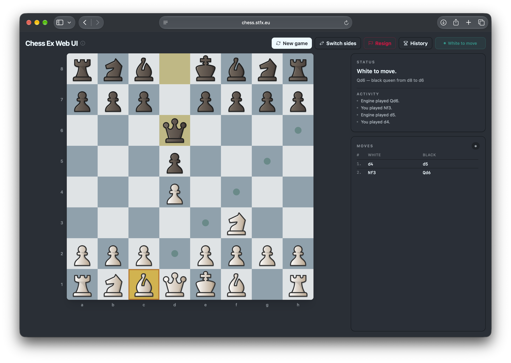
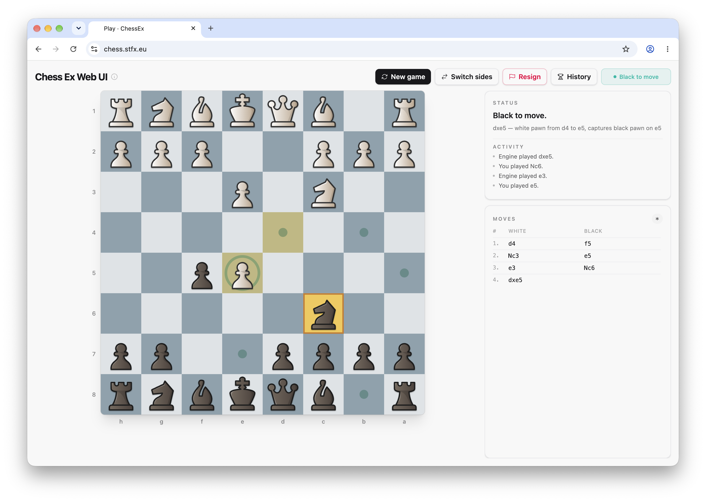
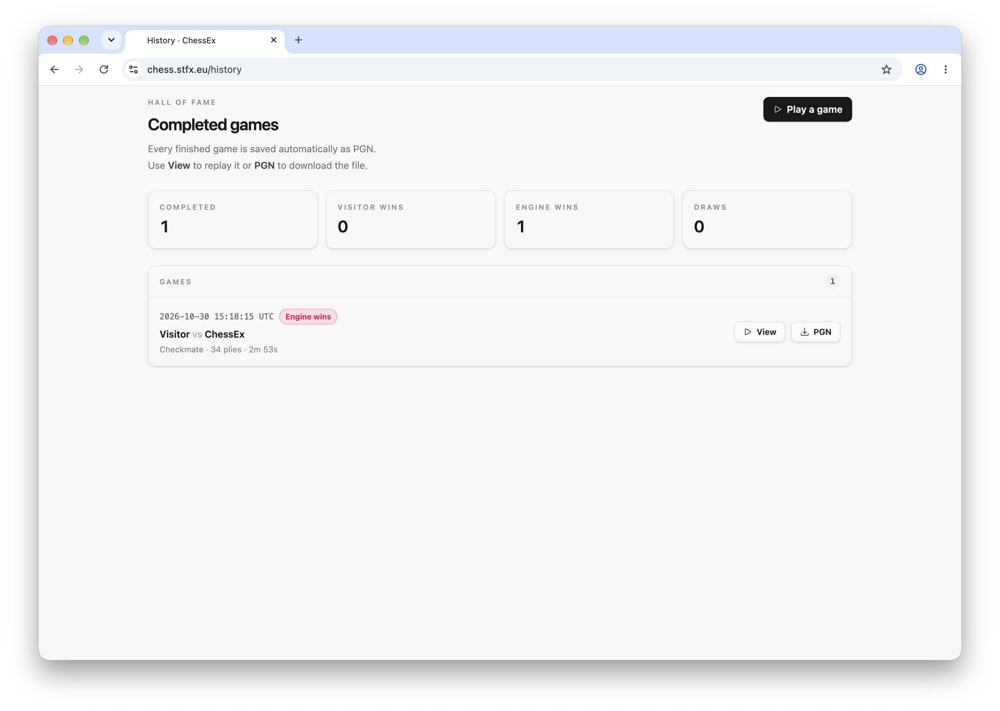
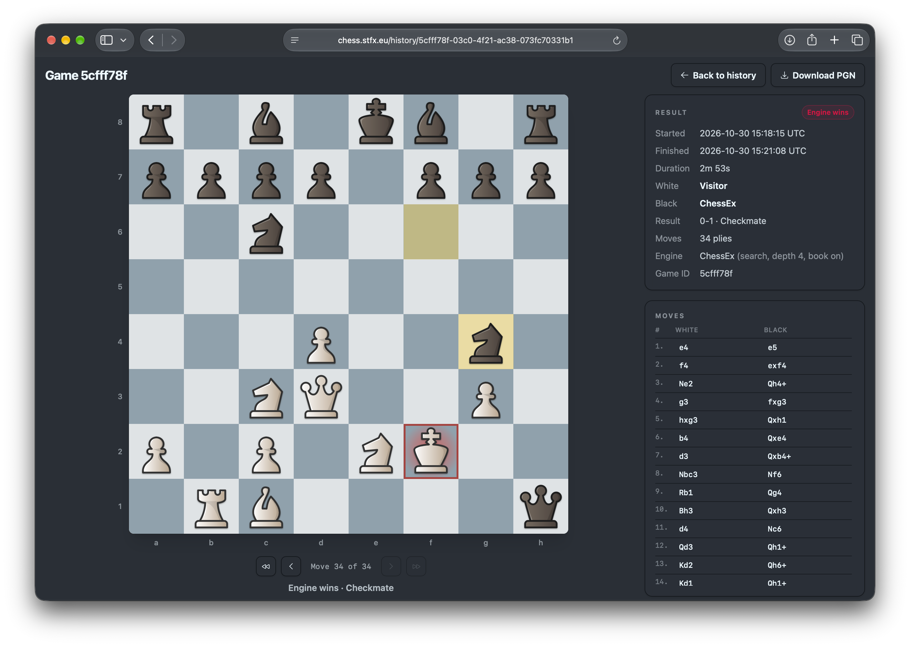
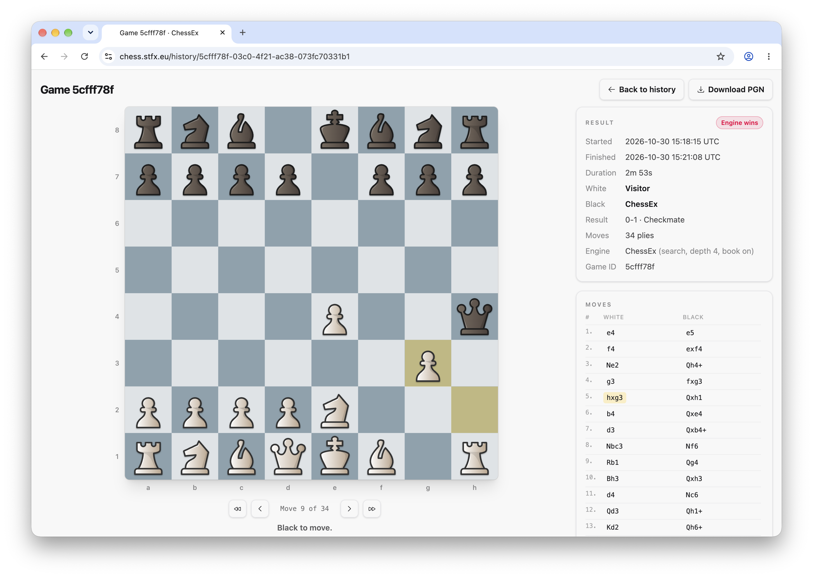

# ChessEx UI

A Phoenix LiveView web interface for playing chess against the pure Elixir
[ChessEx](https://github.com/svenvc/chess_ex) engine. Completed games are saved
as PGN files and can be replayed or downloaded from a chronological hall of
fame.

A live demo can be found at [https://chess.stfx.eu](https://chess.stfx.eu)

## Screenshots

### A game in progess - dark system theme



### A game in progess - light system theme



### The history view - light system theme



### Replaying a game, showing end state - dark system theme



### Replaying a game, mid game - light system theme




## Requirements

- Elixir `~> 1.18`

## Setup

```sh
mix setup
mix phx.server
```

Open <http://localhost:4000/> for the board. `/game` serves the same page as an
alias and `/history` lists the completed games.

Completed games are written to `var/games/` by default. Set
`CHESS_EX_UI_GAMES_DIR` to use another directory, especially in production.

## Playing

- You play White by default. The engine answers with a 4-ply search and uses the
  opening book when the position is known; it thinks in the background while
  the turn indicator shows the progress.
- Click a piece and then a highlighted legal target. Clicking another own
  piece changes the selection; clicking the selected square clears it.
- The selected square, legal destinations, capture targets and the last move
  are highlighted. A king in check glows red.
- File labels are below the board and rank labels to the left. Both reverse
  when you switch sides.
- **New game** resets the board. **Switch sides** starts a new game as the other
  color; if the engine is now White, it opens immediately. **Resign** ends the
  current game.
- The side panel contains the `Chess.Narrator` status, recent activity and a
  PGN-style move list.
- The page is sized to fit one viewport without page scrolling; the side panels
  scroll internally when needed.
- When a game ends, it is saved automatically. The status panel links to the
  saved game and its PGN download.

Current first-pass limits:

- Promotion automatically promotes to a queen.
- In-progress game state lives in the LiveView; refreshing or reconnecting
  starts a new game. Only completed games are persisted.
- There is no clock or settings UI.

## REST API

An anonymous, textual API lets machines and AIs play against the same engine.
It keeps in-progress games in memory and archives finished games in the same
`/history` archive.

```sh
curl -i -X POST http://localhost:4000/api/games
curl -i http://localhost:4000/api/games/{id}
curl -i -X POST --data 'e4' http://localhost:4000/api/games/{id}/move
curl -i -X POST http://localhost:4000/api/games/{id}/move
```

`POST /api/games` returns `201` with a `Location` header. The body of every
successful game response is a FEN; `X-Chess-*` headers carry the side to move,
the player's color, the result, the last move and the archive id. Moves may be
SAN (`e4`, `Nf3`, `O-O`, `e8=Q`) or UCI (`e2e4`, `e7e8q`). The move is plain
text in the body; no content type is required. An empty move body asks the
engine to move; a body of `resign` resigns. JSON request bodies are not
supported and are rejected with `415`.

Errors are also plain text: unknown API paths, malformed bodies and unexpected
failures do not return a Phoenix HTML page.

The player is White by default; use `?color=black` to play Black. Games are
anonymous, live in memory for an hour after the last request and are lost on
restart. Creation, moves and reads are rate limited per address, and the number
of games and concurrent engine searches is capped. `GET /api` prints the full
description.

### Behind a reverse proxy

The API rate limiter keys on `conn.remote_ip`. Behind Caddy, enable the
forwarded-address rewrite at boot:

```sh
CHESS_EX_UI_PROXY_REWRITE_ON=x_forwarded_for
```

The value is a comma-separated list of `Plug.RewriteOn` options:
`x_forwarded_for`, `x_forwarded_proto`, `x_forwarded_host` and
`x_forwarded_port`. Unset or empty leaves the connection untouched, which is the
safe default. Only enable a rewrite when the proxy strips or overwrites the
corresponding header; otherwise a client can spoof its address or scheme.

Caddy at the edge ignores client-supplied `X-Forwarded-For` values and sets the
header to the immediate client address, so the usual setup is:

```caddyfile
chess.stfx.eu {
    reverse_proxy 127.0.0.1:4000
}
```

and:

```sh
CHESS_EX_UI_PROXY_REWRITE_ON=x_forwarded_for
```

Add `x_forwarded_proto` (and optionally `x_forwarded_host`) if you also want
`conn.scheme`/`conn.host` rewritten for the backend:

```sh
CHESS_EX_UI_PROXY_REWRITE_ON=x_forwarded_for,x_forwarded_proto,x_forwarded_host
```

If Caddy is itself behind a CDN, configure Caddy's global
`servers { trusted_proxies ... }` option. `Plug.RewriteOn` takes the first
(leftmost) `X-Forwarded-For` entry; if an upstream proxy passes a chain it did
not sanitize, use a dedicated header instead, for example
`header_up X-Client-IP {client_ip}` in Caddy and this advanced configuration:

```elixir
config :chess_ex_ui, proxy_rewrite_on: [{:remote_ip, "x-client-ip"}]
```

## History and replay

- `/history` lists completed games newest first and shows the visitor's record.
- `/history/:id` opens a read-only replay with first/previous/next/last
  controls and clickable move rows.
- `/history/:id/download` downloads the original PGN.
- Only games with a result are recorded: checkmate, stalemate, the automatic
  draw rules and resignation. Starting a new game, switching sides or closing
  the page does not record the abandoned game.
- The archive is a directory of PGN files, one per game. There is no database,
  and no visitor identity is stored.

## Project structure

| Path | Purpose |
| --- | --- |
| `lib/chess_ex_ui_web/live/game_live.ex` | `/` LiveView (also `/game`): state, clicks, engine turns, status, notation and recording |
| `lib/chess_ex_ui/game_archive.ex` | PGN storage: save, list, fetch and download paths for completed games |
| `lib/chess_ex_ui_web/live/history_live.ex` | `/history`: chronological hall of fame and win/draw stats |
| `lib/chess_ex_ui_web/live/game_view_live.ex` | `/history/:id`: read-only PGN replay |
| `lib/chess_ex_ui_web/controllers/game_download_controller.ex` | `/history/:id/download`: PGN file download |
| `lib/chess_ex_ui/api.ex` | REST API context: create, move, engine turn, resignation and archiving |
| `lib/chess_ex_ui/api/game_store.ex` | In-memory games, expiry, capacity and engine reservations |
| `lib/chess_ex_ui/api/move.ex` | SAN and UCI parsing for API move bodies |
| `lib/chess_ex_ui_web/controllers/api/game_controller.ex` | `/api/games` endpoints |
| `lib/chess_ex_ui_web/controllers/api/docs_controller.ex` | `GET /api`: plain-text API description |
| `lib/chess_ex_ui_web/controllers/api/error_controller.ex` | Plain-text 404/405 for API routes |
| `lib/chess_ex_ui_web/controllers/api/error_text.ex` | Plain-text error view for the API |
| `lib/chess_ex_ui_web/plugs/api_format.ex` | Marks `/api` requests for plain-text errors |
| `lib/chess_ex_ui_web/plugs/parsers.ex` | Answers API parse errors as plain text |
| `lib/chess_ex_ui_web/plugs/api_rate_limit.ex` | Per-address rate limiting for the API |
| `lib/chess_ex_ui_web/game_format.ex` | Shared formatting for history dates, durations and result badges |
| `lib/chess_ex_ui/engine.ex` | Engine strength and book options; test seam for the engine module |
| `lib/chess_ex_ui_web/components/chess_board.ex` | Presentational board, squares, coordinates and highlights |
| `lib/chess_ex_ui_web/chess_assets.ex` | Board/piece asset lookup and theme seam |
| `lib/chess_ex_ui_web/components/layouts.ex` | App shell; `bare` omits the header, `scroll` lets bare history pages grow |
| `assets/css/app.css` | Tailwind entry point and the board-surface rule |
| `priv/static/images/boards/blue.png` | Vendored lichess board texture |
| `priv/static/images/pieces/gioco/` | Vendored lichess Gioco piece set |

## Development

```sh
mix precommit    # compile with warnings as errors, format, run tests
mix assets.build # rebuild Tailwind and esbuild
```

The LiveView tests cover board rendering, coordinate orientation, selection and
legal targets, legal move application, the asynchronous engine reply and thinking
state, illegal clicks, switching sides, starting over and resigning. Archive
tests cover PGN round trips, resignation results, chronological listing,
corrupt-file handling and id validation; history tests cover stats, downloads
and the replay controls. API tests cover game creation, SAN/UCI moves, the turn
guard, engine moves, status codes, rate limiting, expiry and archiving.

### Driving the page from a script

`scripts/play_remote.mjs` plays a game through a real browser, clicking the
board and reading its published state, so it exercises the same path a visitor
takes. It needs Google Chrome and one small package, and it defaults to
`http://localhost:4000`:

```sh
npm --prefix scripts install
node scripts/play_remote.mjs            # plays White, resigns or gets mated
node scripts/play_remote.mjs --headed   # watch it
```

To play move by move from outside the process, keep a session alive and step it.
The session holds the one browser tab the game lives in, binds `127.0.0.1` on a
random port and writes a token to `tmp/play_session.json`:

```sh
node scripts/play_remote.mjs --serve        # start; prints the FEN + legal moves
node scripts/play_remote.mjs --state        # position and every legal move
node scripts/play_remote.mjs --step e2e4    # play it, wait for the engine
node scripts/play_remote.mjs --close --resign
```

To drive the deployed instance instead of a local server, name the host and opt
in explicitly:

```sh
ALLOW_REMOTE=1 node scripts/play_remote.mjs --url https://chess.stfx.eu --serve
```

It refuses any host other than localhost unless `ALLOW_REMOTE=1` is set, because
a finished game is archived permanently in `/history` — a game played against
the deployed instance shows up there for everyone. Treat it as a deliberate,
one-off exercise rather than something to run on a schedule.

The markup it depends on is pinned in
[AGENTS.md](AGENTS.md#scripted-play-black-box-driver).

See [TODO.md](TODO.md) for known first-pass limits and planned work.

## Assets and licensing

The board and pieces are vendored from
[lichess-org/lila](https://github.com/lichess-org/lila) and are not hotlinked.
See [ASSETS.md](ASSETS.md) for the pinned commit, authors and licenses. The
project code is MIT licensed; the assets keep their own licenses. The Gioco
piece set is CC BY-NC-SA 4.0, so it is not suitable for commercial use as-is.
